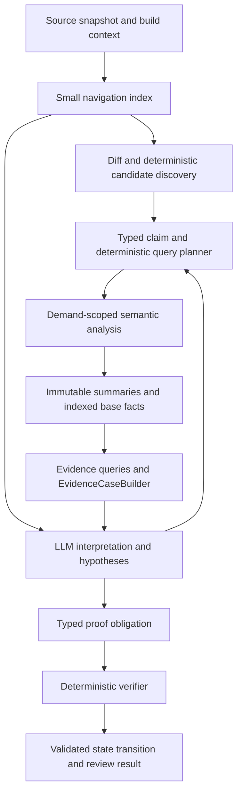

# VERITAS Claim-Driven Redesign: Reconciliation and Delivery Plan

**Status:** Proposed design and staged redesign plan; not approved for implementation.

**Reviewed:** 2026-10-24, against native-runtime baseline `e10fbc1`, then
reconciled with merged PR #152 at `940e9de` (documentation-only changes).

**Purpose:** Make a useful review possible without first materializing the
whole program's derived closure, and let an LLM participate in discovery,
semantic interpretation, and refinement while deterministic tools retain
authority over verified results.

## 1. Inputs, limits, and decision ownership

This proposal follows the request to read `CLAUDE.md`, establish the current
implementation state, and plan a redesign using the conversation
[Review VERITAS Redesign](chatgpt-conversation://6adc01ba-bfc0-83ec-9528-8785741abee1).
The conversation reader exposed only a placeholder for its answer. The user
then supplied the complete saved
[architecture review and redesign proposal](../brainstorm/veritas-architecture-review-and-redesign-proposal.md),
which is the source reviewed here. Its goals are smaller storage, faster
question-specific analysis, and a stronger role for LLM semantic reasoning.
Its key sequencing decision is to deliver a real lightweight review loop
before the full storage/scaling programme. The copied reference is retained
unchanged as a historical review, not a live status authority.

[PR #152](https://github.com/skg7on/VERITAS/pull/152) merged on 2026-10-24 as
`940e9de`. Its proposed [architecture 06](../architecture/06-review-agent-architecture.md),
[review-driven analysis specification](veritas-review-driven-analysis-design-spec.md),
and [Review Agent delivery roadmap](../plans/veritas-review-agent-milestone-roadmap.md)
are now on remote `main`. This document reconciles the supplied review with
that direction and adds concrete runtime/storage gates; it is a follow-up,
not a competing architecture. Incorporate approved refinements into those
canonical documents rather than implementing two plans.

The user supplied the goals above. The supplied review recommends the hybrid
architecture and P0–P4 sequencing. The detailed scope, initial budgets,
interfaces, and additional acceptance targets below are the author's proposals. Existing
approved specifications remain authoritative until explicit amendments are
approved. This document does not replace their contracts merely by describing
a successor.

This is a design and planning change only. No product implementation,
benchmark rerun, dependency installation, or production-readiness claim is
part of this review.

## 2. Current state: code versus status prose

| Area | Observed baseline | Implication |
| --- | --- | --- |
| Native analysis | `ProjectAnalyzer::Impl::AnalyzeProject` runs project ingestion, linked LLVM IR/local summaries, mandatory SVF, summary/CPG publication, then WPA | Even a narrow review currently pays the project analysis cost |
| WPA | `RunWpa` requests reachability, memory effects, flow, and effects; `WpaOrchestrator::Run` visits every SCC/component and retains completed results | Scope is the whole run, even when the eventual question is one sink |
| Semantic authority | WPA consumes Function Summary IR; CPG is a thin query projection | Replacing a graph database alone would not address the main architecture |
| Provenance | M9 fact publication, rooted witnesses, current/history bindings, schema-v4 receipts, and Explain are present | Preserve these assets and failure guarantees |
| Evidence | M10B query APIs and M10C builder, validator, identities, projections, and codecs are present | Start from these boundaries; rebuilding Evidence IR would duplicate delivered work |
| Producer coverage | Native ranges, capacities, queryable aliases, and positive dominating checks remain deferred in the delivered demo contract | A validated EIR case is not yet a demonstrated general overflow verifier |
| Query cost | `EvidenceReadSnapshot` exposes `GetCurrentFacts()`; `BuildEvidenceInput` repeatedly obtains and scans current facts for its fact slots | A bounded result does not imply bounded backend work or memory |
| Incrementality | Component caches and SCC hashes exist; scheduled predecessors are returned as a list that no code executes or persists | M7/M8 mechanisms do not yet give an end-to-end incremental review pipeline |
| Scaling instrumentation | `ScaleProfile`, `veritas-store-diff`, and the M13 acceptance record are present; `scaled` remains reserved/rejected | Reuse the measurement harness; do not equate its existence with delivered scaling |
| Agent integration | Agent/verifier workflow and Claude review plugin have specifications; the approved plugin already allows bounded `request_source`; the tutorial identifies agent dispatch, verification transitions, and Evidence persistence as future work | Broaden discovery and context without claiming that bounded source access is wholly new |
| Portable identity | Architecture 05 proposes a fix for host-derived target features; `CLAUDE.md` identifies it as pending | Cross-host cache reuse must wait for qualification of the target identity contract |

Sources: [project orchestration](../../src/analysis/ProjectAnalyzer.cpp),
[WPA orchestration](../../src/wpa/WpaOrchestrator.cpp),
[analysis configuration](../../include/veritas/analysis/ProjectAnalyzer.h),
[evidence queries](../../src/evidence/EvidenceQueryService.cpp),
[read snapshot interface](../../include/veritas/evidence/EvidenceReadBackend.h),
[SCC durability contract](../../include/veritas/wpa/SccStateRepository.h),
[Agent tutorial](../guides/tutorial-agent-code-review.md), and
[portable identity architecture](../architecture/05-portable-analysis-target-identity-architecture.md).

At the pre-#152 baseline, `CLAUDE.md` and milestone indexes lagged the code:
M10B/M10C were described as planned, and the plan matrix labeled M8R.3–M8R.5
outstanding and M9 planned. PR #152 reconciles those delivery labels and
historical performance figures while preserving explicit producer and semantic
gaps. P0 should verify those gaps, not repeat completed status-only edits.
The M10B sink-resolution amendment remains marked proposed/not yet applied;
its presence is not an implemented callsite resolver. GitHub state checked on
2026-10-24 shows
#133 and #132 closed, while #124, #125, #140, #143, #144, #149, and #151 remain
open. Closure alone does not prove that the current local source implements
the acceptance criteria. In particular, #133's historical numerical limits
are not claimed met, and the #132 scope still needs implementation disposition.

The correctness audit
[#149](https://github.com/skg7on/VERITAS/issues/149) also identifies containment,
complete-empty/open-world handling, relation epistemic allowlists, provenance
depth, summary references, and link-unit membership gaps. These are P0
acceptance work, not prerequisites that can be assumed solved merely because
M10B/M10C types and serializers exist. Audit findings not independently
reproduced in this review must be verified with focused regression cases.

## 3. What the measurements establish

These are repository records, not fresh measurements of `e10fbc1`.

| Observation | Recorded evidence | Interpretation and limit |
| --- | --- | --- |
| Post-round-3 LevelDB run | 39 TUs; 3,429 summaries/SCCs; 13,716 component executions; 1,249,792 fact rows; 1,375,911 provenance edges; `metadata.db` 2.82 GiB | The semantic result and its representation are substantial before Agent use |
| Same profile | 418.702 s CPU; publication 119.998 s; WPA orchestration 157.318 s, including canonicalization 66.056 s and execution 42.034 s | Soufflé execution alone is not the dominant measured cost; nested spans must not be added twice |
| Same profile | CPG projection 2.180 s; SVF 74.847 s; post-SVF resident floor recorded around 3.21 GiB | Neither deleting CPG projection nor changing only the Datalog executor removes the whole cost |
| Round 4 arena experiment | Equivalent results, but CPU +70.151 s; no measurable process-peak reduction; arena reverted | Do not repeat compact storage with decode/render overhead in every consumer |
| Surviving round 4 canonicalizer | Recorded worst-of-three CPU 420.231 → 390.855 s; instructions −7.5%; no established RSS improvement | The older 421.67 s headline predates the retained change; PR #152 corrects that status prose, but this remains a cross-session comparison, not a current benchmark |
| Overall store size | Scaling roadmap reports a user observation of 4–7 GiB, explicitly unmeasured; the 2.82 GiB SQLite file above is measured separately | Do not claim a measured total-store size or extrapolate a measured 1 MLOC footprint |

See [round 4 §§2, 9.5, 9.6](veritas-build-analyze-round4-performance-design-spec.md),
[scaling roadmap §§2–5](../plans/veritas-scaling-milestone-roadmap.md), and
[M13 acceptance record](milestones/m13-scale-profile-acceptance-record.md).
Round 4's surviving state does not carry every full acceptance artifact; this
review does not infer passing tests from its performance table.

There is also an algorithmic concern independent of timings:
[GlobalFlow](../../logic/flow/global_flow.v2.dl) composes derived flow with
derived flow, and the reachability domain carries transitive successor
support. All-pairs closure can require quadratic output on a call chain.
That is a worst-case property, not proof that the LevelDB fixture has reached
that regime. M14's synthetic topology experiments are still needed.

## 4. Goals, preserved assets, and alternatives

Success means a reviewer can start from a change, a suspicious operation, or a
semantic question; receive useful context quickly; request precise analysis
for that question; and distinguish a supported result from incomplete work.
Storage and computation should primarily follow indexed source, reusable
boundary summaries, and the claims actually investigated.

Preserve content-addressed identities, immutable program snapshots,
component-level semantic dependencies, uncertainty, rooted provenance,
deterministic canonicalization, and the M10B → M10C typed handoff. Retain C++20,
Clang/LLVM, the pinned SVF and Soufflé integrations, SQLite/RocksDB, Protobuf,
Z3, and `Status`/`StatusOr` conventions initially. No new database, compiler
framework, model vendor, or serving platform is required by this proposal.

| Direction | Benefit | Limitation | Recommendation |
| --- | --- | --- | --- |
| Continue eager analysis with representation and execution tuning | Lowest semantic migration risk; existing equivalence instrument applies | Still pays for broad closure before a narrow review; limited change to the LLM's role | Keep as baseline and reuse independently valuable M13–M18 work |
| Replace deterministic analysis with LLM-generated summaries | Broad semantic exploration and cheap initial experiments | Model interpretations cannot establish sound aliases, absence, path feasibility, or proof | Use only as a separately labeled hypothesis channel |
| Claim-driven hybrid | LLM discovers/interprets; tools compute bounded evidence and verify precise claims | Requires explicit scope/completeness contracts, local analysis boundaries, and workload evaluation | Proposed target |

The proposal does not promise complete vulnerability detection, universal
automatic proofs, a near-linear cost for inherently dense queries, or a fixed
large speedup before measurement. A review with no candidates is not a
repository safety certificate. Broad audits remain an explicit expensive mode.

## 5. Target architecture

The LLM is useful before and between proof steps: interpreting naming and
business intent, proposing missing preconditions, finding suspicious changes,
recognizing custom validation conventions, forming counterexample ideas, and
choosing which evidence to request next. It may also explain contradictions
and suggest external models. These are proposals until admitted by a typed
producer or verifier.

The deterministic planner validates every scope and analysis operation and
accounts for budgets. Model ranking may choose which claims receive attention;
it cannot certify that unvisited code is irrelevant.

### 5.1 Three analysis tiers

**Navigation.** Persist symbols, source/build mappings, definitions, callsite
anchors, syntactic calls, includes, and source digests. Use the existing ingest
and Clang infrastructure where practical. This tier must work without linked
whole-program LLVM IR, SVF construction, or global closure. An unresolved
indirect call stays unresolved; syntax is not a semantic call graph.

**Reusable local semantics.** Compute local value/CFG relations, effects, and
boundary summaries for requested functions or modules. Summaries describe
parameters, returns, escaped memory, preconditions, and explicit unknown
effects rather than every transitive internal pair. Publish a capability
manifest for each producer: supported relations, admitted scope, uncertainty,
and analysis configuration. Local cost can still include a full translation
unit; a function budget is not a promise of function-only compiler work.

**Precision and verification.** Refine a selected claim using SVF, constrained
Soufflé rules, range/capacity/check producers, or a configured SMT/path verifier.
Run expensive LLVM/SVF ownership in a supervised worker with a memory/time
limit and serializable inputs/outputs. Worker exit can release its address
space; its benefit must be measured including parent memory, child memory,
serialization, startup, and any whole-program prerequisite.

SVF remains required for native alias results until a qualified replacement
contract exists. Navigation does not claim that capability. Demand-driven
SVF is not assumed to eliminate global graph construction: the existing DDA
approach operates over an SVFG, so the bootstrap cost needs its own experiment.

### 5.2 Scope and completeness

A claim query pins source/revision/build target, the selected producer versions,
summary/fact bindings, requested relation, boundary policy, and budgets.
The planner follows semantic dependencies and handles whole SCCs rather than
cutting recursion at an arbitrary function count. Unknown indirect targets,
callbacks, escaped memory, external calls, or omitted callers produce explicit
frontier entries unless an admitted conservative boundary summary covers them.

Completeness has two dimensions: traversal of the chosen representation and
coverage of the producer's semantics. A complete scan of an unsupported range
relation does not prove that a value has no range. A traversal-complete scoped
query is not globally complete when its program frontier is open.

Negative facts require both the existing closed-world admission rule and a
complete semantic scope for that predicate. In particular, do not infer
`MUST_NOT` merely because no guard appeared in a bounded source excerpt, an
unsupported producer returned an empty slot, or the planner stopped at a
budget. Preserve the currently admitted M10B closed-world behavior in baseline
mode; any change to its admission policy requires an explicit contract revision.

Demand computation materializes an immutable query artifact first. Every
subquery of one Evidence case then reads the same finalized snapshot. Refining
or widening the scope creates a new snapshot and case; it never mutates a
pinned case halfway through assembly.

The proposed artifact descriptor records the requested predicate and endpoints,
admitted function/SCC set, boundary summaries, unresolved frontier, producer
capabilities, deterministic limits, dependency digests, returned-member digest,
and completion outcome. Its content address distinguishes queries over the
same revision. Query-artifact publication is separate from a whole-program M9
run receipt: a completed scoped computation must never masquerade as a complete
global analysis run. P2 versions the query-completion/snapshot contract to bind
this descriptor, while baseline runs retain their existing identities and
receipt semantics. Existing `summary.v2` artifacts remain readable; a new
compositional boundary-summary format is additive and versioned separately.

### 5.3 Bounded source access for the LLM

The approved plugin already permits bounded `request_source` for advertised
entity/source-anchor targets when semantic evidence is insufficient (§10.4).
Preserve that capability. The proposed amendment is earlier source/diff-driven
candidate discovery and bounded test/document context before an EIR case
exists, as already outlined in PR #152. This needs context-artifact references
and admission rules; it does not grant ambient repository access.

The tool returns selected function bodies, type definitions, nearby checks,
comments, and versioned specifications with source digest, snapshot, anchors,
and byte/token limits. It cannot select a different revision or arbitrary
filesystem paths. Source and documentation text are untrusted observations;
they may suggest intent but never establish `MUST`, `MUST_NOT`, or verification.
The model cannot edit analyzed code or publish its own learned models.

Store model output separately as hypotheses with model/configuration identity,
prompt/tool transcript digests, cited source/evidence references, assumptions,
and suggested proof obligations. Model confidence remains separate from
epistemic state. Repeatability applies to deterministic artifacts for fixed
inputs; it is not a promise that different model runs discover identical claims.

### 5.4 Datalog's narrower role

Keep Soufflé as the default production recursive executor for existing domains.
Introduce query-bound rule bundles for individual flow/effect/reachability
questions. Initially use explicit query seeds and relation-specific scope
filters. Do not compute all-pairs flow and then filter its output.

Evaluate Soufflé magic-set specialization as an experiment, not a switch
promised to work on the current witness rules: the documented transformation
excludes dependencies involving functors, negation, or aggregates. Current
semantic-key/witness rules use string functors. Any rewritten kernel must be
qualified with provenance and epistemic outcomes, not only tuple counts.

Within a recursive region, compute the required fixed point or report a
bounded/incomplete result. Emit selected finite rooted proof DAGs for admitted
results; do not drop required witness premises to hit a memory budget. A
selected proof demonstrates a result, while a negative conclusion needs its
separate completeness argument.

### 5.5 Storage, publication, and cache identity

Keep SummaryDB's logical responsibilities. Distinguish durable source/base
facts and boundary summaries; claim-scoped derived artifacts and proof DAGs;
rebuildable indexes; and optional historical materializations. CPG remains a
query projection, loaded or constructed for selected scopes in demand mode.

Add relation/entity-indexed paged reads under `EvidenceReadSnapshot`; the
query service must not fetch the whole run and only then apply a result budget.
Limits account for examined rows, frontier expansion, returned members, proof
size, and cancellation. A keyset cursor belongs to one pinned snapshot.

Stream canonical publication into staging owned by a run/query manifest. Keep
one bounded window resident. A single durable publication transition makes
the complete manifest current; incomplete staging is not visible as complete.
Recovery must preserve M9's receipt/idempotency semantics. This requires a
publication amendment; it is not permission to expose half a fact batch.

Use binary/dense identifiers inside execution and indexes; preserve stable
content-addressed IDs at artifact boundaries. Avoid per-consumer decoding and
key rendering introduced by the reverted arena experiment. Changes to public
canonical bytes, fact/witness selection, or IDs need versioning and an additive
migration, not a new comparison mask.

A query cache key binds program/build target, relation and typed query,
semantic scope/frontier policy, producer/rule/model versions, dependencies,
and deterministic work/output limits. Store actual result membership,
completion, and operational timeout/cancellation as artifact metadata. An
interrupted artifact cannot satisfy a complete request. Larger-budget requests
must not reuse a smaller partial answer as complete.

Dependency hashes, not just revision IDs or timestamps, enable cross-revision
reuse. Validate target/layout/configuration and negative dependencies such as
an unresolved target set: a new caller or newly resolved callee can invalidate
an earlier result even if its old positive premises did not change. Portable
identity qualification is a dependency for cross-host semantic reuse.

Garbage collection roots include current snapshots, explicitly retained history,
published findings, and their proof/input manifests. Temporary staging and
unreferenced query artifacts may be reclaimed; supporting facts for a retained
finding may not. Measure live logical bytes and physical WAL/SST/index bytes
separately, including compaction/retention state.

### 5.6 Separate semantic contracts

Persist reusable contracts only after P1 demonstrates their value. A contract
artifact records the subject, predicate, preconditions/effects/invariants,
source/test/doc references, origin (`DOCUMENTED`, human supplied, or
`LLM_INFERRED`), assumptions, snapshot/dependencies, version, and verification
status/result reference. It is separate from formal Function Summary IR and
never acquires authority merely by being cached or cited by another model.

An unverified release/callback invariant can guide retrieval and conditional
checks. It cannot become the premise that proves that very invariant. Admission
to a trusted model bundle requires independent validation or an explicit trusted
policy and a versioned qualification corpus. Replay establishes an observed
schedule/input; it does not establish all schedules. This is the Semantic
Contract IR direction in the supplied review, with an intentionally narrow
review-annotation precursor in P1.

## 6. First product slice and proposed limits

The first release reviews pinned real C/C++ base/working changes without a
prebuilt full WPA database. It must demonstrate two kinds of investigation:

1. **Analytical defect:** a removed destination bound for a local 32-byte array,
   while a separate payload-source bound remains. Use PR #152's `memcpy`
   example first; indexed read/write detectors need separate qualification.
   Produce compiler-grounded extent/operand evidence and a snapshot-bound,
   configured sanitizer replay of the proposed 33-byte input. The changed
   execution must reproduce the out-of-bounds write and the base must reject
   that input. This is a concrete verified defect for that execution, not a
   universal safety proof for the base or the whole program. Unsupported
   replay cannot satisfy this release gate with an uncertain result instead.
2. **Semantic contract observation:** investigate whether resource release
   cancels or safely fences an already queued callback before it next uses
   the released resource. This is the supplied review's
   `ReleaseConnection`/scheduler example. Cite the state writes, callback
   registration/dispatch, cancellation path, and selected tests/docs. Unless
   an independent trace or model check establishes the ordering, report the
   concern with an explicit assumed execution model. No concurrency verifier
   or new authoritative EIR claim kind is required to report this observation.

P0 selects and freezes adjudicated real changes matching these two cases,
including a correct cancellation/guard control; small fixtures are regression
companions. A synthetic-only demonstration does not meet the real-change gate.
If no suitable real change is available, report the corpus gap and keep P1
unqualified rather than inventing a defect. Contract observations live in a
typed review annotation, separately from `EvidenceCase` and authoritative facts.

The local provider only needs the capabilities these cases require. It may
use Clang AST/local IR and a configured replay harness; it must not construct
whole-program SVF/WPA just to obtain a local array extent. Reuse baseline
stores opportunistically and report their cold construction cost separately.
Qualify wider ranges, aliasing and full check producers under #124 in separate
slices without claiming those criteria are met by this narrow case.

Proposed initial per-claim limits, subject to P0/P1 calibration:

| Resource | Initial proposal | On exhaustion |
| --- | ---: | --- |
| Admitted functions / SCCs | 64 / 8, whichever binds first | Return frontier and partial coverage; do not cut and certify an SCC |
| Examined semantic rows / proof edges | 100,000 / 20,000 | Stop with explicit incomplete reason |
| Precision worker | 60 s wall / 1 GiB hard process-memory limit | Terminate safely; preserve an incomplete diagnostic artifact |
| Source context per model step | 32 KiB and 8,000 tokens | Return omission/expansion handles |
| Model steps / aggregate input | 8 / 32,000 tokens per claim | Emit pending obligations and usage; do not imply proof |

These are stop policies, not promised success envelopes. If a sound boundary
or SVF bootstrap cannot fit, the result is incomplete or the user chooses a
larger explicit budget. The parent process also needs a measured budget;
limiting one worker does not bound total review RSS. Model selection,
transport, pricing, and source-disclosure policy remain deployment choices.

## 7. Staged delivery plan

Use the supplied review's P0–P4 labels; PR #152's R0–R5 remain its own product
gates. Do not renumber M13–M19. Each delivery gets a focused executable plan
after design approval. P1 does not depend on P2 or P3.

| Stage | Deliverable | Code and document seams | Exit gate |
| --- | --- | --- | --- |
| P0: Correctness and measurement | Reconcile #149; scoped sink/containment, completeness, epistemic/provenance/summary integrity; freeze real-change corpus and Debug/Release/byte baselines | Existing Evidence/CPG/fact validators, #124 and closed #132 scope, `RunMetrics`, M13/M14 harness; align PR #152 status prose | Opaque validators reach EIR; unsupported/empty/truncated results remain distinct; forbidden authority rejected; provenance limits and summary refs exercised; seeded perturbations detected |
| P1: Real lightweight review | Small structural/local provider, bounded diff/source/test/doc context, dual candidate admission, capability controller, real replay adapter, local report | Existing ingest/Clang extraction, review-plugin/controller/backend contracts, M10C mapping/codecs where supported | No full database/SVF/WPA required; both §6 cases investigated on real changes; analytical replay decides; semantic concern cites its contract and uncertainty; malformed output or wrong verifier snapshot rejected |
| P2: Query-driven analysis/storage | Indexed pinned reads and cursors, typed scope planner, boundary summaries, query-seeded kernels, precision workers, immutable query artifacts, streaming publication | `EvidenceReadBackend`, `FactStore`, `EvidenceQueryService`, WPA/executor/`logic/` seams, SummaryDB staged manifests | Fixed-scope reads avoid unrelated scans; supported answers/proofs match qualified oracles; unsupported producers/open frontiers stay explicit; child failure/staging crash exposes no partial current snapshot; aggregate memory measured |
| P3: Operational incrementality | Source/build-to-summary invalidation, executable WPA worklist, query/Evidence cache lifecycle, negative dependencies, retention/GC | M7 scheduler, SCC state, `WpaRunRepository`, `AnalysisFactBus`, fact/object stores | No-op executes zero semantic components and appends no unchanged payload; edit matches clean recomputation; relevant additions invalidate negative answers; retained proof roots survive GC |
| P4: Justified semantic/formal expansion | Reusable semantic contract artifacts; selected SVF/SMT/path/replay capabilities, resource/state-machine analysis | Separate contract annotation/store, verifier registry and transition validation; optional provider adapters | Held-out ablations show useful quality/coverage gain per added cost; no circular proof of inferred contracts; timeouts never promote; production default selected only after measured gates |

P0 integrity is a gate for production analytical claims; source-only evaluation,
corpus preparation, and controller development can proceed independently.
Fake backends are permitted for protocol tests but cannot satisfy P1. Indexed
reads from P2 may land early as an independent responsiveness fix; the complete
storage migration is not a P1 prerequisite. After P1, source/local/deep ablations
determine which P2/P4 precision experiments deserve further investment. Full
closure retention changes need their own contract review. All product pushes
use isolated worktrees and the repository's full verification requirements.

### 7.1 Mapping to the existing PR and trackers

| Supplied review | Existing PR #152 direction | Reconciliation |
| --- | --- | --- |
| P0 | R0 integrity and R1 analytical case | Keep #149 as umbrella; verify closed #132's remaining implementation scope; #124 retains full producer acceptance |
| P1 | R2 source/evidence review and early R3 evaluation | Add the independently runnable local provider and decisive replay; precomputed-store integration alone is not lightweight qualification |
| P2 | Selective-refinement R4 plus measured scaling work | Version scoped artifacts and streaming separately; preserve full-run receipts |
| P3 | R5 repeated-review economics | #143/#144 plus Evidence lifecycle; #125 gates portable reuse |
| P4 | Evaluation-gated R4 and future contract support | Separate inferred contracts from formal summaries and verifier assumptions |

The existing review roadmap already gets the product order right. Prefer
focused amendments to it over a second implementation programme. This proposal
does not authorize remote issue edits, PR changes, or merging PR #152.

### 7.2 Relationship to existing scaling plans

Reuse M13's equivalence instrument and M14's topology/size experiments. M15's
identity representation, M16's incremental execution, and M17's streaming
publication directly support P2/P3. P2/P4 overlap M18's selective PTA and M19's
conditional compositional closure; bring their algorithmic experiments forward
for the demand-mode product slice without asserting that those milestones are
already approved or delivered in this new form.

Keep two different acceptance contracts. Representation-only baseline work
uses the existing byte/identity equivalence projection. Demand mode intentionally
stores fewer facts and uses versioned scoped semantics: compare normalized
claim answers, assumptions, completeness, uncertainty, and checkable rooted
proofs for the same query. Whole-store byte equality is inappropriate there.
It is also insufficient by itself: two empty stores are equal. Assert required
content and use seeded wrong-fact, wrong-proof, missing-frontier, and
false-negative-certificate controls.

Portable target identity can proceed independently, but do not duplicate its
architecture or enable cross-host cache sharing before its acceptance gate.
External Joern/PhASAR adapters and additional claim kinds remain outside this
first vertical slice. The proposal does not require abandoning their designs.

## 8. Acceptance and evaluation

P0 records actual baselines before targets are ratified. The following are
proposed product targets, not achieved results:

* Adopt the source proposal's initial lightweight targets for qualification:
  structural index live bytes at most 20% of full-analysis live bytes on matched
  fixtures; warm structural query P95 under 2 s; pre-indexed bounded-change
  first review P95 under 30 s, including observed model latency. Record cold
  index, model, and precision-provider costs separately. Measure P95 over at
  least 100 attempts/queries per declared workload, not three timing runs.
* On the pinned LevelDB workload, time to the first navigable source/symbol
  result should be at most 20% of the same-build eager analysis time and use
  at most 25% of its aggregate peak RSS; report absolute figures too.
* For a fixed claim with a closed, supported frontier, adding ten times as
  many disconnected functions should change examined semantic rows and
  newly materialized claim facts by no more than 10%. Source indexing is
  measured separately and may grow with the repository.
* The initial demand-mode store plus the declared retained claim workload
  should use at most 25% of eager baseline live bytes on the same fixture.
  Report coverage and claim count beside the ratio; deleting useful answers
  is not an optimization. Do not claim this ratio for an exhaustive audit.
* A no-op review executes no semantic components. A one-function edit executes
  only changed/local prerequisites and its admitted invalidation cone, or
  documents a conservative fallback with counters. Identical outputs must
  match a clean recomputation of the new snapshot.
* Unsafe copy, safe dominating guard, sibling/non-dominating guard, mixed paths,
  opaque validator, indirect call, escaped alias, cross-TU flow, recursion,
  budget truncation, and changed-target cases have required and forbidden
  outcomes. Preserve both contradiction and unresolved premises.
* Evaluate the LLM using fixed tasks, configurations, and budgets against
  deterministic discovery alone: candidate recall, false positives, additional
  useful hypotheses, verified outcomes, abstentions, time-to-first-useful-case,
  tool/model latency, tokens, and monetary cost. Repeat model runs and report
  variability. No arbitrary model confidence threshold becomes proof.

Freeze the source proposal's ablation ladder: A = bounded-source LLM;
B = A plus lightweight index/summaries; C = B plus local compiler evidence;
D = C plus selective SVF/Datalog/SMT; E = the existing full WPA/Evidence path.
Use the same tasks and aggregate resource budgets, and report unavailable
capabilities rather than substituting synthetic answers. Run both fixed-candidate
verification tests and end-to-end discovery tests. Include contract/lifetime/
async cases and clean controls, so improvement on overflow cannot conceal poor
semantic recall. Independently adjudicate findings and missed critical defects;
record human review effort as well as machine cost. P1's initial A–C experiment
must precede general P4 precision investment.

Run synthetic chains, stars, disconnected components, dense SCCs, indirect
dispatch, and high-alias fixtures at multiple sizes, alongside real projects.
Distinguish the fixed-query cost from the cost of enumerating all answers:
demand evaluation can still become quadratic when the workload requests all
pairs. Record Debug and Release separately; never compare ratios across
compiler, build, target, or workload changes. Use at least three deterministic
runs and state swap/load conditions; report wall time only with those limits.

## 9. Decisions to revisit and implementation handoff

Before product implementation, review the reconciled scope and extend the
canonical direction merged in PR #152 as needed. Early LLM discovery, broader context-artifact
admission, the structural/local provider, and later scoped publication need
explicit contracts. Bounded `request_source` and non-authoritative supported
concerns already have a basis in the approved plugin design.

The author's concrete calls are a local-bounds replay as the first deciding
analytical case, a release/callback contract as the first semantic observation,
and a lightweight P1 independent of the storage migration. No model provider
or hosted service has been selected. Selection must honor the user's source
disclosure preferences; this planning task sends no reviewed source to a new
model service.

After design approval, write focused P0 and P1 executable plans in `docs/plans/`:
regressions for the audited integrity gaps; a frozen real-change corpus;
snapshot/context and candidate APIs; minimal local evidence/annotation schemas;
the replay request/result and authority transition; exact test/build commands;
and cold/warm/A–C benchmark manifests. Keep the existing M9 publication and
identity rules intact in those slices. P2 receives its own scoped-read and
schema/publication migration plan later; it must not hold the first review
product hostage to full closure or storage redesign.

## 10. External technical references

* [Soufflé magic-set transformation](https://www.souffle-lang.com/magicset):
  query specialization and restrictions involving functors, negation, and
  aggregates. Check the vendored revision before selecting an implementation.
* [SVF framework](https://github.com/SVF-tools/SVF): available analysis families,
  including demand-driven points-to analysis. This does not establish that the
  VERITAS-pinned integration has a low-memory demand API.
* [SUPA demand-driven pointer analysis](https://yuleisui.github.io/publications/tse18.pdf):
  SVFG-based refinement, relevant to separating query cost from graph bootstrap.
